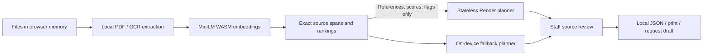

# ReferralGlass

**Every detail, in view.** A source-linked referral-packet desk for a small medical office.


ReferralGlass helps a referral coordinator find the paperwork requested by their receiving office. It runs a real open model in the browser, shows the original source page, and requires staff confirmation before a passage enters the handoff. Its bounded planner and agent frontend are hosted on **Render**.

Built on 18 October 2026 for [Hacktoberfest Week 2: Side Hustle](https://dev.to/challenges/hacktoberfest-week2-2026-10-12). Entering **Best Use of Render** only. The new repository, ingestion workflow, source-span index, planner, interface, fixtures and evaluations were created during this challenge window.

This is an administrative challenge prototype. Use fictional or de-identified documents. It has no clinical validation, real clinic pilot, paying customer, regulatory certification, identity reconciliation, or EHR integration. It does not diagnose, determine urgency, authorize treatment, or decide whether a clinical referral is appropriate. The receiving practice sets its own paperwork requirements.

## Try the complete workflow

1. Open [the live app](https://referralglass.onrender.com/) ([verified deployment](docs/deployment.json)), or run it locally below.
2. Choose **Try a sample packet**. Four fictional files contain six pages; the investigation report is explicitly pending.
3. Choose **Find evidence**, consent to the generic model download, and let MiniLM run on your browser CPU.
4. Inspect candidate quotes, alternatives and original pages. The pending-report mention cannot be confirmed as supplied paperwork. Other passages require an explicit staff acknowledgement.
5. Prepare a handoff, copy the missing-paperwork draft, save source-linked JSON, or print/save a PDF. Nothing is sent to another practice automatically.
6. Load the complete sample packet to explore the alternate path. The **Retrieval lab** runs a reproducible comparison in your own browser.

You can import PDF, UTF-8 TXT/MD and PNG/JPEG/WebP. Enable English OCR for scans. The downloadable two-page [fictional PDF](web/public/samples/referral-cover.pdf) and [scan fixture](tests/fixtures/clinic-scan.png) make PDF and OCR behavior easy to try. They are software fixtures, not clinical forms or a valid authorization template.

## What the AI actually does

The pinned Apache-2.0 model [`Xenova/all-MiniLM-L6-v2`](https://huggingface.co/Xenova/all-MiniLM-L6-v2) encodes office requirements and source passages into 384-dimensional vectors through Transformers.js and ONNX Runtime Web. It uses quantized `q8` weights, WASM CPU inference, normalized mean pooling, 256-token truncation, and batches of eight. The model searches by semantic similarity; it generates no medical narrative.

A deterministic, bounded review planner checks the best five source pages per item. Similarity below 0.28, competing matches within 0.045, explicit pending/absent language, poor OCR and office date limits remain visible for review. These are illustrative prototype heuristics, not clinically calibrated thresholds. They can miss negation, misleading context, mixed patients, missing pages or contradictory records. Staff must inspect the original and confirm packet identity and relevance.



The cloud API accepts only anonymous reference syntax, bounded scores and booleans. It rejects unknown fields and raw text payloads. It never automatically approves an item. Disable **Use the Render planner** to keep the planner local too; an unavailable server automatically uses the same local code. An activity record exposes each planning step.

## Data flow and limits

| Item                                                                              | Where it goes                                                                                                             |
| --------------------------------------------------------------------------------- | ------------------------------------------------------------------------------------------------------------------------- |
| Files, filenames, text, OCR images, quotes, checklist descriptions, confirmations | Browser memory; included in local exports only as documented                                                              |
| Generic model/tokenizer assets                                                    | Downloaded from Hugging Face at a pinned revision; the provider sees ordinary connection metadata                         |
| Anonymous document/page/chunk references, cosine scores, quality flags            | Render `/api/plan` when enabled; no session database or request-body logging in application code                          |
| App, WASM, OCR engines and English language data                                  | Self-hosted on Render and cached as generic assets                                                                        |
| Working packet                                                                    | Cleared on reload or **Clear workspace**; never placed in localStorage, IndexedDB or the service-worker cache by this app |

Normal hosting/network logs may retain connection metadata. This is not an independent security audit or an anonymity guarantee. Browser/OS behavior, extensions, clipboard history and exported files are outside the app's control. Clearing memory is not a secure-erasure guarantee. Keep exports in an approved secure workflow.

First use downloads roughly 50 MB of generic model/runtime assets; OCR downloads additional generic assets on first scan. No inference API key, GPU or paid voice service is used. After the necessary assets have loaded, the app, model and local planner can work offline. First use still needs internet, and a browser can evict its cache.

Limits: 12 files, 10 MB/file, 20 pages/file, 240,000 packet characters, 300 passages, 12 checklist items. PDF extraction, English OCR and text normalization can lose layout or introduce errors. Original source images remain available for inspection. Handwriting and non-English OCR are outside the supported prototype scope. Office date limits rely on an explicit ISO document-date heading or a staff-entered date, not inferred clinical validity.

## Run locally

Node.js 24 or later and npm are required.

```sh
npm ci --ignore-scripts
npm run dev
```

Open `http://localhost:4176`. English OCR data is vendored with a verified SHA-256, and PDF/OCR/ONNX assets are prepared from locked packages. Native Node inference install scripts are intentionally unnecessary; inference runs in the browser.

```sh
npm test
npm run build
npm start
```

Production listens on `PORT` (default 4176), binds `0.0.0.0`, serves the compressed runtime, and exposes `GET /api/health`. `POST /api/plan` has a strict 32 KB JSON bound and a modest per-IP rate limit. It has no document-upload endpoint, database or secrets.

## Verify it

- [Unit and API tests](tests): source fidelity, tamper detection, date/absence handling, unsafe text, API bounds and valid compressed MIME types.
- [Live Render checks](docs/live-qa.json) verify the deployed commit, genuine browser inference, Render planning, PDF/OCR and JSON export.
- [Browser QA report](docs/browser-qa.json): real local model, PDF import, real English OCR, source review, exports, mobile layouts, network-marker checks and offline reload. All records and staff actions in this test are synthetic/automated. The clipboard API is stubbed, and actual A4 PDF generation is checked separately from the print-button stub.
- [Fixed 24-case retrieval report](docs/retrieval-benchmark.json): semantic retrieval **21/24**, TF-IDF cosine **21/24**. The methods make different errors; the aggregate is a tie. This small software fixture is not clinical accuracy, production readiness, measured office time saved, or proof of superiority over keyword search. The corpus was fixed before its first model run; the published labels/results were not altered to improve the score.

To reproduce browser checks after a production build:

```sh
npx playwright install chromium
npm run test:browser
```

On Windows the runner uses an isolated installed Chrome profile by default; set `REFERRALGLASS_BROWSER_PATH` to override. On other systems it uses Playwright's Chromium. It never connects to an existing signed-in browser. CI runs the same software checks using synthetic fixtures.

## The side-hustle hypothesis

A small independent practice might pay for reusable office checklists, private packet preparation, clean handoffs and support. **$29/month per office is an unvalidated price hypothesis**, not an active subscription. There is no claimed first customer or measured return on investment. The next validation step would be a consented, de-identified pilot measuring completion errors, staff time and willingness to pay. Real healthcare deployment would require a separate privacy, security, legal and clinical workflow assessment.

## Render deployment

Create one **Free Node web service**, with no database or paid add-ons:

- Repository: this public repository, branch `main`.
- Build: `npm ci --ignore-scripts --include=dev && npm run build`
- Start: `npm start`
- `NODE_VERSION=24.18.0`, `NODE_ENV=production`.
- Health endpoint: `/api/health`.

The public Git URL uses manual deploys; push the reviewed commit, then deploy it. Render hosts the agent UI, stateless planner and compressed inference/OCR runtime assets. Browser inference avoids sending document text to a hosted model and keeps memory requirements small for the web service. Free web services sleep after inactivity, share workspace allowances, and are for prototypes; the free tier is not a production healthcare hosting plan. See [Render's current free-instance limits](https://render.com/docs/free).

## Credits and license

Project code is MIT. Models, engines, fonts and OCR data retain their own licenses; see [THIRD_PARTY.md](THIRD_PARTY.md). AI coding assistance was used, and the cover was generated with OpenAI's image tool; [artwork provenance and the exact prompt](docs/artwork.md) are included. Product screenshots show the real running application and fictional data.

Generic deployment/cache experience from my earlier [Stillroot](https://github.com/faraz-shamim/stillroot) and [ASCEND](https://github.com/faraz-shamim/ascend) projects informed the setup. ReferralGlass is a new repository and medical administrative workflow; those earlier projects are not being resubmitted. The sample checklist is illustrative. [AHRQ's referral guidance](https://www.ahrq.gov/health-literacy/improve/precautions/tool21.html) provided background on organizing a referral and relevant information; it does not validate this software or prescribe these six office rules.

No post-deadline code changes have been made. Any later changes after the challenge deadline must be identified here.
